# Site-to-Site VPN Lab — WireGuard on Proxmox

Two simulated branch offices on isolated subnets, joined by an encrypted WireGuard
tunnel across a simulated WAN link. Everything runs on a single Proxmox VE host
using a mixed VM / LXC topology.

**Result:** a host on Site A (`10.0.1.10`) reaches a host on Site B (`10.0.2.10`)
with no route between the two LANs other than the tunnel.

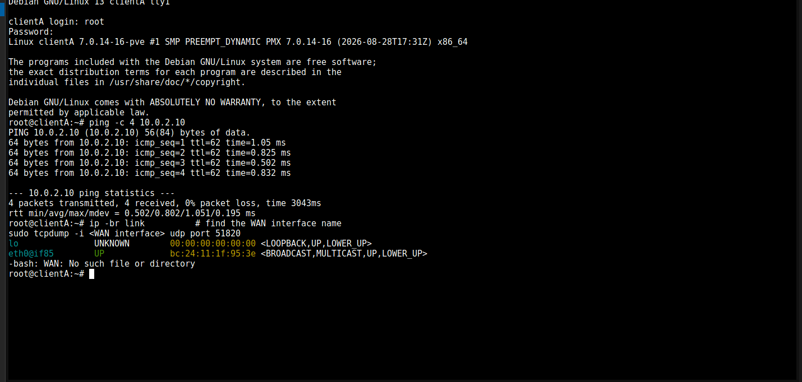

---

## Contents

- [Topology](#topology)
- [Address plan](#address-plan)
- [Why this mix of VMs and containers](#why-this-mix-of-vms-and-containers)
- [Build walkthrough](#build-walkthrough)
- [Verification](#verification)
- [Problems hit along the way](#problems-hit-along-the-way)
- [Repo layout](#repo-layout)
- [Next steps](#next-steps)

---

## Topology

```
                            Proxmox VE host "pve"

  ┌───────────────┐                                      ┌───────────────┐
  │   clientA     │                                      │    ClientB    │
  │   LXC 9001    │                                      │   LXC 9004    │
  │  10.0.1.10/24 │                                      │  10.0.2.10/24 │
  └───────┬───────┘                                      └───────┬───────┘
          │ eth0                                            eth0 │
  ════════╧════════ vmbr10            vmbr20 ════════════════════╧═══════
      (Site A LAN)                                        (Site B LAN)
          │ ens20                                           ens20 │
  ┌───────┴───────┐                                      ┌───────┴───────┐
  │    RouterA    │ ens19    vmbr30 — simulated WAN   ens19    RouterB   │
  │    VM 9002    ├──────────────────────────────────────┤    VM 9003    │
  │  10.0.1.1/24  │ 192.168.100.1/30    192.168.100.2/30 │  10.0.2.1/24  │
  └───────┬───────┘                                      └───────┬───────┘
          │                                                      │
          └──── wg0 10.10.10.1/30 ══ WireGuard ══ 10.10.10.2/30 ─┘
                            UDP 51820, ChaCha20-Poly1305
```

`vmbr10`, `vmbr20` and `vmbr30` are Linux bridges with **no physical port attached**.
A Proxmox bridge is just a virtual switch, so a bridge with no uplink is a fully
isolated broadcast domain — which is exactly what makes this a believable
"two separate sites" test bed rather than two hosts on the same LAN.

## Address plan

| Segment | Network | Purpose |
|---|---|---|
| Site A LAN | `10.0.1.0/24` | `vmbr10` — RouterA `.1`, clientA `.10` |
| Site B LAN | `10.0.2.0/24` | `vmbr20` — RouterB `.1`, ClientB `.10` |
| WAN link | `192.168.100.0/30` | `vmbr30` — RouterA `.1`, RouterB `.2` |
| Tunnel | `10.10.10.0/30` | `wg0` — RouterA `.1`, RouterB `.2` |
| Build-time uplink | `192.168.10.0/24` | `vmbr0`, temporary, for installing packages |

The WAN link and the tunnel are both `/30` on purpose: a point-to-point link only
ever has two hosts, so a `/30` (2 usable addresses) says so in the addressing itself.

## Why this mix of VMs and containers

| Role | Type | Reason |
|---|---|---|
| RouterA / RouterB | KVM VM | WireGuard needs to create a network interface via the kernel's `wireguard` module. An **unprivileged LXC container can't do that** — it has no `CAP_NET_ADMIN` in the host namespace. |
| clientA / ClientB | LXC | The clients only need to send traffic, never terminate the tunnel. Containers boot instantly and cost ~512 MB instead of 2 GB. |

Routers get 2 GB RAM / 32 GB disk each; clients get 512 MB RAM / 8 GB disk.
On a single host, that difference matters.

---

## Build walkthrough

### 1. Create the three isolated bridges

Added on the Proxmox host under **System → Network**, each with `bridge-ports none`:

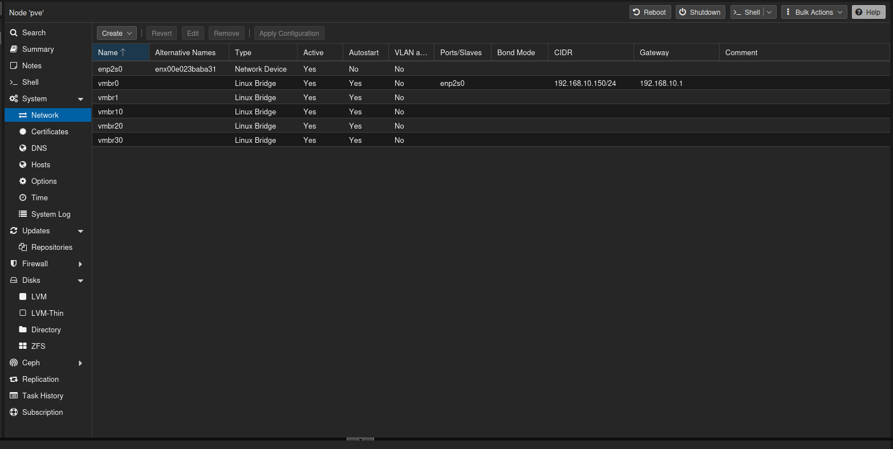

Only `vmbr0` has a physical port (`enp2s0`) and an address — that's the host's own
uplink. `vmbr10`, `vmbr20` and `vmbr30` are deliberately bare.

Confirmed from the host shell:

```bash
ip -br link show type bridge
```

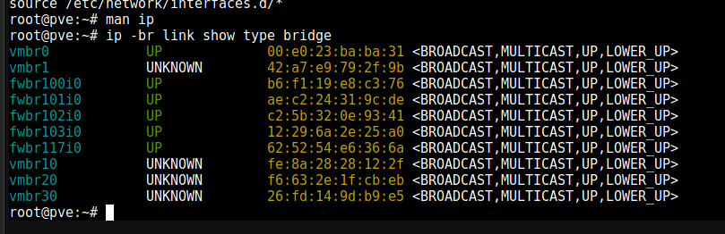

The new bridges show `UNKNOWN` rather than `UP` because nothing is plugged into
them yet — no VM NICs, no physical port.

See [`configs/proxmox/interfaces.snippet`](configs/proxmox/interfaces.snippet).

### 2. Build RouterA

Debian 13.2 from the netinst ISO, 1 core, 2 GB RAM, 32 GB disk:

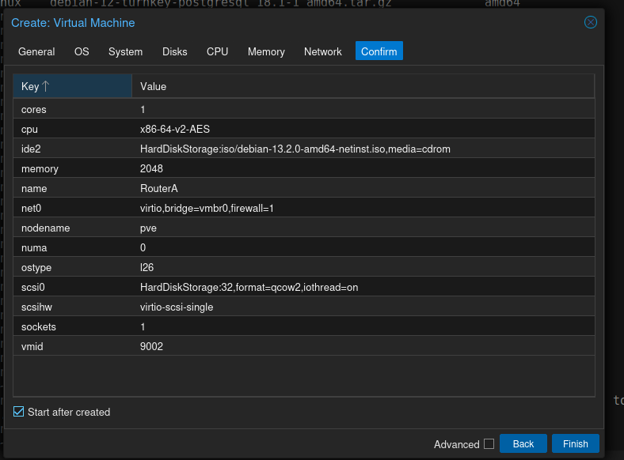

It was installed with **only** a `vmbr0` NIC so the installer had internet access.
The lab NICs were added afterwards, once the base system was up:

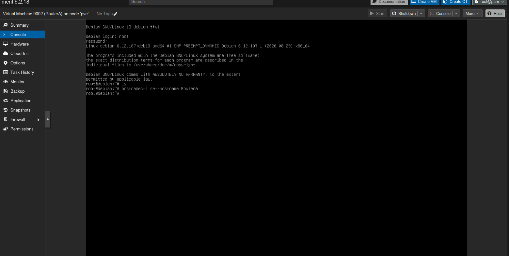

```bash
hostnamectl set-hostname RouterA
```

### 3. Attach the WAN and LAN NICs

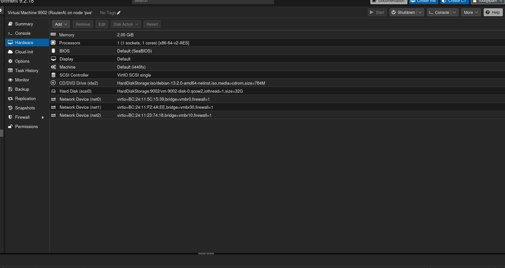

| Device | MAC | Bridge | Guest interface | Role |
|---|---|---|---|---|
| net0 | `BC:24:11:5C:15:39` | vmbr0 | `ens18` | temporary uplink |
| net1 | `BC:24:11:F2:4A:EE` | vmbr30 | `ens19` | WAN |
| net2 | `BC:24:11:23:74:18` | vmbr10 | `ens20` | Site A LAN |

Guest interface names don't tell you which bridge they're on. **Match them by MAC
address** — compare the Proxmox hardware list against `ip -br link` inside the VM.
Guessing here is how you end up with the LAN address on the WAN port.

### 4. Give the interfaces static addresses

```bash
cat >> /etc/network/interfaces <<EOF

auto ens19
iface ens19 inet static
    address 192.168.100.1/30

auto ens20
iface ens20 inet static
    address 10.0.1.1/24
EOF

ifup ens19
ifup ens20
ip -br addr
```

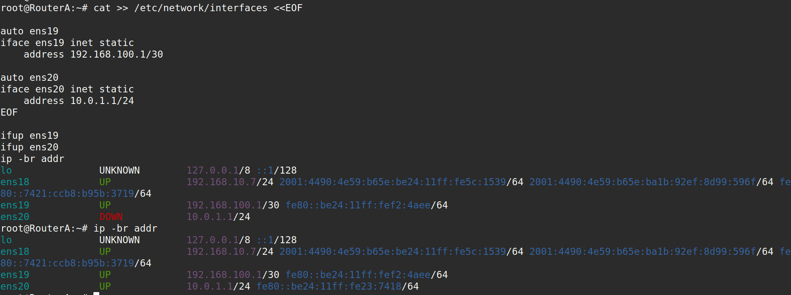

Note `ens20` reporting `DOWN` on the first `ip -br addr` and `UP` on the second —
`ifup` had not finished bringing the link up when the first command ran.

Full files: [`configs/routerA/etc/network/interfaces`](configs/routerA/etc/network/interfaces)

### 5. Clone RouterA into RouterB

Cloning beats a second install, but a clone is *identical*, and three of those
identical things have to change:

| What | Why |
|---|---|
| LAN bridge `vmbr10` → `vmbr20` | RouterB lives on Site B |
| Hostname and both static IPs | `192.168.100.2/30`, `10.0.2.1/24` |
| `/etc/machine-id` | Debian derives the DHCP client identifier from it — two VMs sharing one machine-id fight over the same lease |

```bash
# on RouterB, after cloning
hostnamectl set-hostname routerB
rm -f /etc/machine-id && systemd-machine-id-setup
```

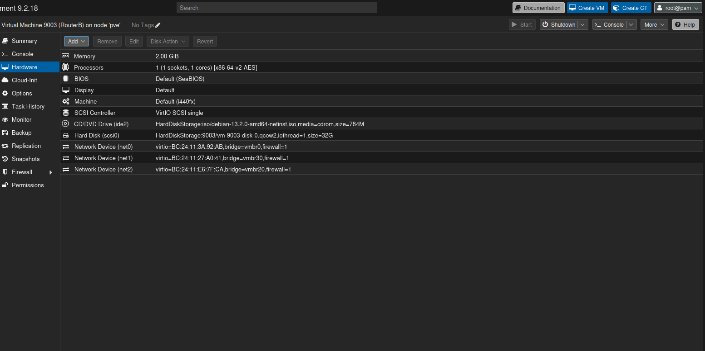

### 6. Create the clients as LXC containers

clientA — unprivileged, on `vmbr10`, gateway pointed at RouterA:

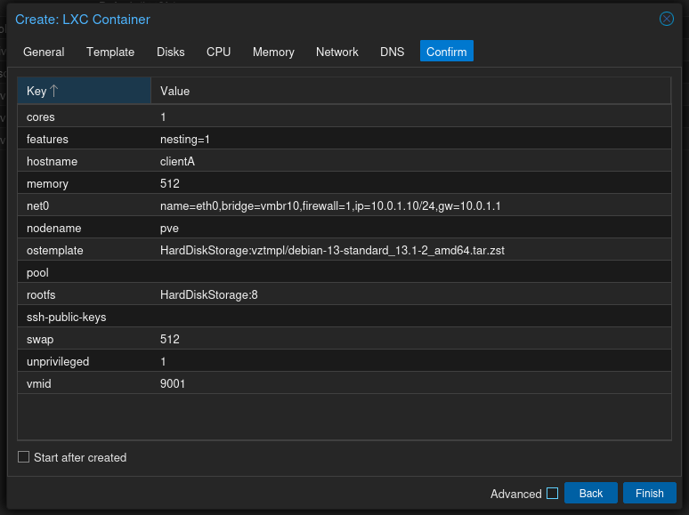

ClientB — same shape, on `vmbr20`, gateway pointed at RouterB:

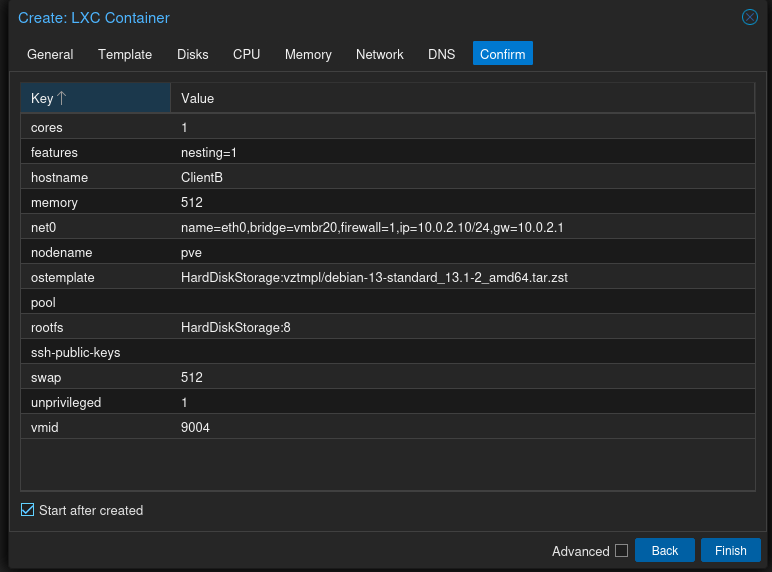

The `net0` line does the whole job:
`name=eth0,bridge=vmbr10,ip=10.0.1.10/24,gw=10.0.1.1`. The gateway is what makes
the client hand off-subnet traffic to its router instead of dropping it.

### 7. Install the tooling on both routers

```bash
apt install -y wireguard nftables tcpdump traceroute
```

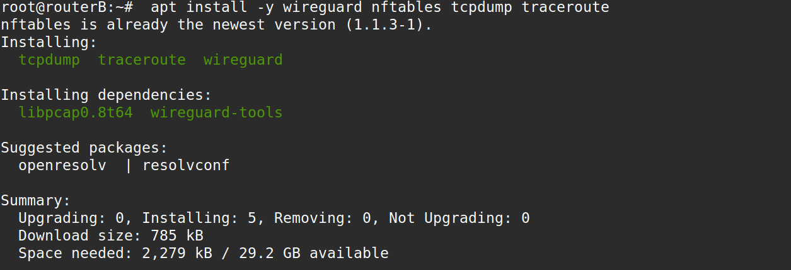

### 8. Enable IP forwarding

This is the single kernel setting that turns a Linux box into a router. Without it
the kernel silently drops any packet not addressed to itself.

```bash
echo "net.ipv4.ip_forward=1" > /etc/sysctl.d/99-forwarding.conf
sysctl --system
sysctl net.ipv4.ip_forward
```

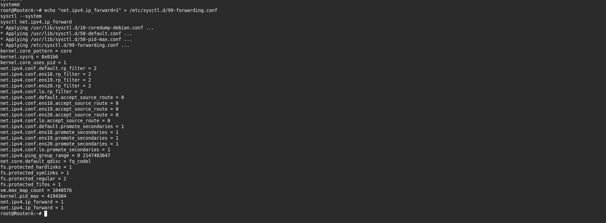

On Debian 13 there is no `/etc/sysctl.conf` to edit — kernel settings live in
drop-in files under `/etc/sysctl.d/`. `sysctl --system` replays every drop-in in
order, which is why `net.ipv4.ip_forward = 1` prints twice at the end.

### 9. Generate a keypair on each router

```bash
wg genkey | tee privatekey | wg pubkey > publickey
```

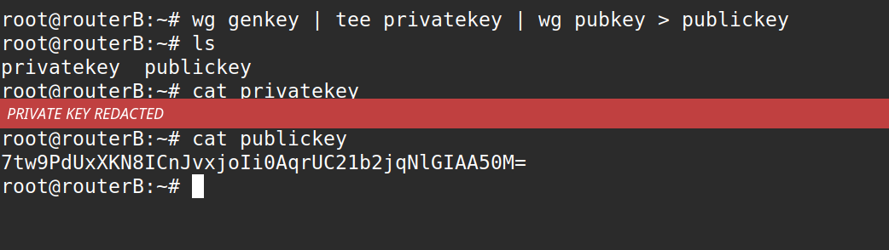

> The private key in this screenshot is redacted. See [Security note](#security-note).

Each router keeps its own private key and is given the **other** router's public key.
The private key never leaves the box that generated it.

### 10. Write the tunnel config

RouterA's `/etc/wireguard/wg0.conf`:

```ini
[Interface]
PrivateKey = <RouterA private key>
Address    = 10.10.10.1/30
ListenPort = 51820

[Peer]
PublicKey           = 7tw9PdUxXKN8ICnJvxjoIi0AqrUC21b2jqNlGIAA50M=   # RouterB
Endpoint            = 192.168.100.2:51820
AllowedIPs          = 10.0.2.0/24
PersistentKeepalive = 25
```

```bash
chmod 600 /etc/wireguard/wg0.conf
wg-quick up wg0
systemctl enable wg-quick@wg0
wg show
```

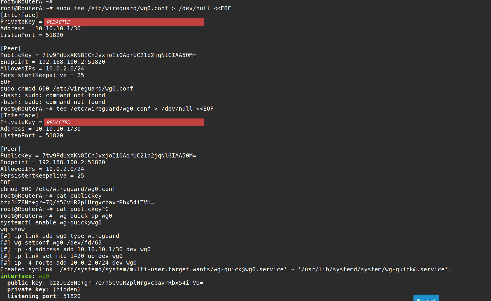

**`AllowedIPs` is the interesting line.** In WireGuard it does two jobs at once,
which is why the design is called *cryptokey routing*:

1. **Outbound — it's a route.** `wg-quick` literally runs
   `ip -4 route add 10.0.2.0/24 dev wg0` (visible in the screenshot). Anything bound
   for Site B goes into the tunnel.
2. **Inbound — it's an ACL.** A decrypted packet whose source address isn't inside
   that peer's `AllowedIPs` is dropped. A peer can only claim the addresses you
   assigned it, so a compromised peer can't spoof another site's traffic.

Both directions, one line, no separate firewall rule.

`wg-quick` also sets MTU 1420 on `wg0` — 1500 minus WireGuard's 80-byte overhead,
so encapsulated packets don't fragment on the underlying link.

Full files:
[`configs/routerA/etc/wireguard/wg0.conf.example`](configs/routerA/etc/wireguard/wg0.conf.example) ·
[`configs/routerB/etc/wireguard/wg0.conf.example`](configs/routerB/etc/wireguard/wg0.conf.example)

---

## Verification

`wg show` reports the interface up, listening on 51820, with a handshake completed
against the peer.

End-to-end, from clientA to ClientB — across two routers and the tunnel, with no
other path between the subnets:

```
root@clientA:~# ping -c 4 10.0.2.10
64 bytes from 10.0.2.10: icmp_seq=1 ttl=62 time=1.05 ms
64 bytes from 10.0.2.10: icmp_seq=2 ttl=62 time=0.825 ms
64 bytes from 10.0.2.10: icmp_seq=3 ttl=62 time=0.502 ms
64 bytes from 10.0.2.10: icmp_seq=4 ttl=62 time=0.832 ms

4 packets transmitted, 4 received, 0% packet loss, time 3043ms
rtt min/avg/max/mdev = 0.502/0.802/1.051/0.195 ms
```


**`ttl=62` is the part worth reading.** Linux starts ICMP at TTL 64 and every router
that forwards a packet decrements it by one. 64 − 62 = **2 hops**: RouterA and
RouterB. That single number proves the traffic was genuinely routed between two
separate subnets rather than answered by something on the local segment.

---

## Problems hit along the way

Each of these cost real time, and each has a reason worth knowing.

### `sudo: command not found`

Debian's installer **skips installing `sudo`** when you set a root password — it
assumes you'll use `su`. Commands copied from Ubuntu-flavoured guides fail
immediately. You're already root, so drop the `sudo`.

Visible in the screenshot at step 10: two `-bash: sudo: command not found` lines
before the command was re-run without it.

### `/etc/sysctl.conf` doesn't exist on Debian 13

The monolithic config file is gone; kernel parameters now live in drop-in files.
Use `/etc/sysctl.d/99-forwarding.conf` and apply with `sysctl --system`.

### RouterB kept RouterA's IP address after cloning

Editing `/etc/network/interfaces` wasn't enough. `ifupdown` keeps a runtime record
of which interfaces it has already configured, and that state was cloned along with
the disk — so `ifup` decided there was nothing to do.

```bash
ip addr flush dev ens20
ifdown --force ens20
ifup ens20
```

### clientA couldn't reach the internet

Its default gateway is RouterA, and RouterA has no NAT to the outside world — it
only knows about `10.0.1.0/24`, the WAN `/30`, and the tunnel. Correct behaviour for
a router that isn't an internet gateway, but inconvenient when you need `apt`.

Fixed by temporarily routing the container through the home router for the duration
of the install. The alternative is to add a masquerade rule on RouterA, which would
have meant a NAT path between the sites competing with the tunnel.

### Ping from RouterA to ClientB failed while the tunnel was up

The most instructive failure here. When **RouterA itself** originates a packet toward
`10.0.2.10`, the kernel picks a source address from the outgoing interface — which is
`wg0`, so the source becomes `10.10.10.1`. That address is **not** inside RouterB's
`AllowedIPs` (`10.0.1.0/24`), so RouterB decrypts the packet, sees a source it hasn't
authorised for that peer, and drops it.

This is `AllowedIPs` doing its ACL job correctly. Two ways through it:

```bash
ping -I 10.0.1.1 10.0.2.10       # force the LAN address as source
```

or just test from clientA, which is the traffic the tunnel actually exists to carry.
Widening `AllowedIPs` to include `10.10.10.0/30` would also work, at the cost of
loosening the filter.

---

## Repo layout

```
.
├── README.md
├── configs/
│   ├── proxmox/
│   │   └── interfaces.snippet            # the three isolated bridges
│   ├── routerA/etc/
│   │   ├── network/interfaces
│   │   ├── sysctl.d/99-forwarding.conf
│   │   └── wireguard/wg0.conf.example
│   └── routerB/etc/                      # same shape, Site B values
└── docs/
    └── images/                           # build screenshots
```

Config files are tracked with private keys replaced by placeholders — see below.

## Security note

Two of the original screenshots showed WireGuard **private keys** in plaintext
(`cat privatekey`, and the `PrivateKey =` line of `wg0.conf`). Those regions are
redacted in the images committed here.

They belonged to a throwaway lab on isolated bridges with no route to the internet,
so the exposure was contained — but the habit is the point: a WireGuard private key
is the entire identity of a peer.
Anyone holding it can impersonate that router to the other side. Keep `wg0.conf` at
mode `600`, and never let it reach a screenshot, a paste, or a repo.

Public keys are safe to publish and are left intact — that's what they're for.

## Next steps

- [ ] **Packet capture.** Run `tcpdump -i ens19 -n` on RouterA's WAN interface during
      a ping and confirm the only thing crossing `vmbr30` is UDP/51820 — no readable
      ICMP, no visible `10.0.x.x` addresses. (The first attempt ran on clientA, which
      has no WAN interface; it needs to run on the router.)
- [ ] **nftables policy** on both routers to restrict what may traverse the tunnel,
      rather than allowing any-to-any between the sites.
- [ ] **Remove the temporary `vmbr0` NICs** from both routers, so the only path
      between the two sites is the tunnel and nothing else.
- [ ] Add a second peer to model a third branch office.

---

## Environment

| | |
|---|---|
| Hypervisor | Proxmox VE 9.2.18, single node `pve` |
| Routers | Debian GNU/Linux 13, kernel 6.12.107+deb13-amd64 |
| Clients | Debian 13 LXC (`debian-13-standard_13.1-2_amd64`), unprivileged |
| VPN | WireGuard (`wireguard-tools`), UDP 51820 |
